# AIGUAT · Catalonia Flood Lab

**A 3D flood early-warning lab for Catalonia, built entirely on public data.**
Click anywhere in Catalonia, push the river and the sea up, and see which streets, buildings and 250 m blocks go under water. Live ACA river gauges, reservoirs and forecasts set the scenario, and alerts are drafted below city level.

[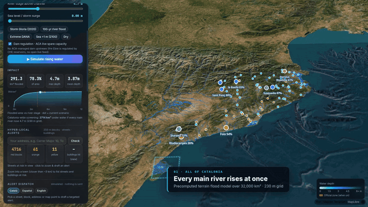](docs/aiguat-showcase.mp4)

▶ **[Watch the full showcase video (1 min 43 s)](docs/aiguat-showcase.mp4)**

> Indicative, terrain-based model for exploration and planning. **Not for real emergency decisions.**

---

## Contents

1. [Run it](#run-it)
2. [What you can do](#what-you-can-do)
3. [How the model works](#how-the-model-works)
4. [Data sources](#data-sources)
5. [Validation and limits](#validation-and-limits)
6. [Roadmap: how to take the model further](#roadmap-how-to-take-the-model-further)
7. [Code map](#code-map)

---

## Run it

Plain HTML/CSS/ES modules, no build step and no API keys.

```bash
python3 -m http.server 8080
# open http://localhost:8080/
```

The app opens on Catalonia. Pick a hotspot (Delta de l'Ebre, Girona · Onyar-Ter, Besòs…) or click anywhere to analyse a 15 km or 30 km box.

---

## What you can do

### 1. See all of Catalonia at once
A precomputed screening layer (230 m grid, main rivers) rises and falls with the same sliders, so every basin can be compared at a glance. Zoom in and the detailed local model takes over.

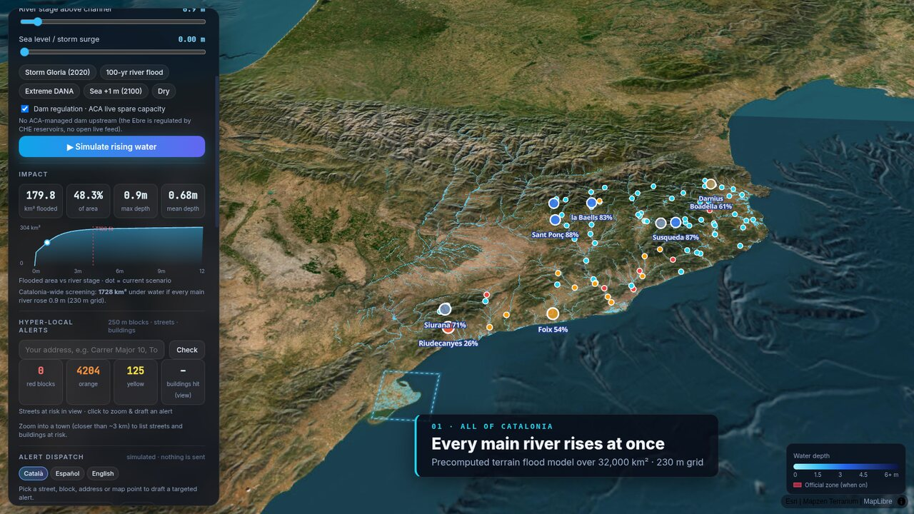

### 2. Run a local 3D flood model anywhere
Click any point: the browser fetches ~30 m elevation tiles, builds the drainage network and computes water depth for every cell in about 3 seconds. The **river stage** and **storm surge** sliders, the presets (Storm Gloria 2020, 100-year flood, extreme DANA, sea +1 m by 2100) and *Simulate rising water* animate the flood over the 3D terrain.

### 3. Hyper-local alerts: 250 m blocks, streets and buildings
Water depth is summed per 250 m block to give a red / orange / yellow level:

| Level | Rule (per block) |
|---|---|
| 🔴 Red | max depth ≥ 1 m **and** ≥ 10 % of the block flooded |
| 🟠 Orange | max depth ≥ 0.3 m **and** ≥ 3 % flooded |
| 🟡 Yellow | ≥ 2 % flooded |

Click a block to see its depth, flooded share and streets, then draft an alert for exactly that block.

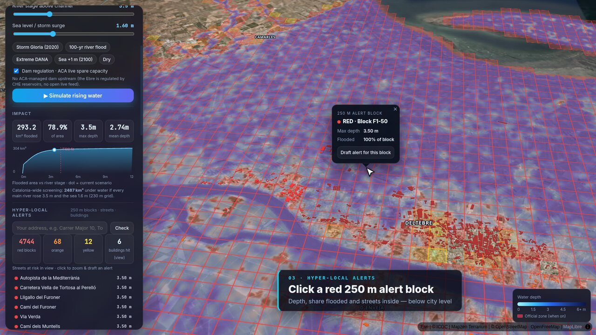

### 4. Check an address
Type an address (ICGC geocoder). You get the water depth at that building, its alert level, the nearest ACA gauge, and flooded buildings highlighted in 3D.

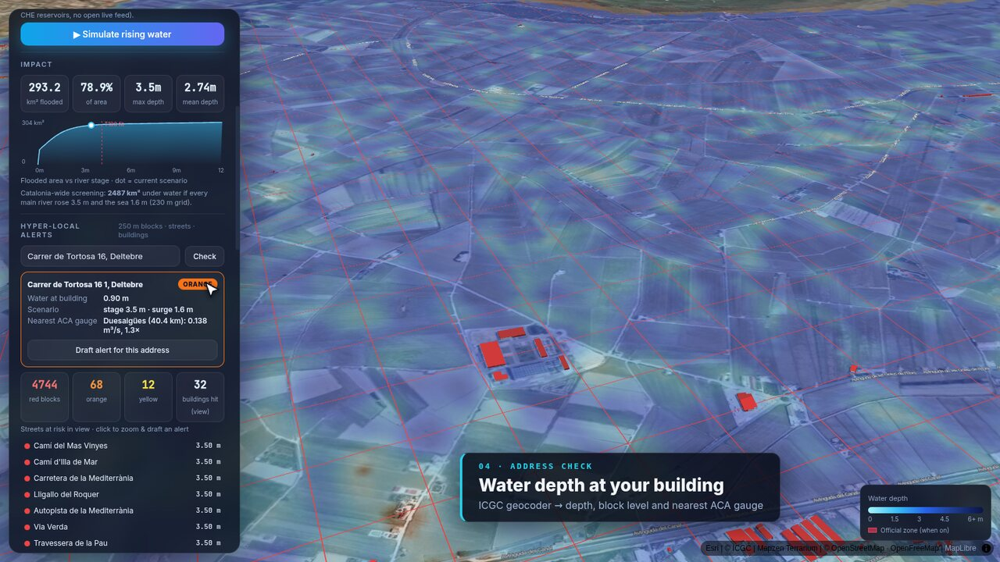

### 5. Draft the warning in three languages
ES-Alert, SMS and push texts in Català, Español and English, scoped to the block, street or address. *Sending is simulated*: nothing is delivered.

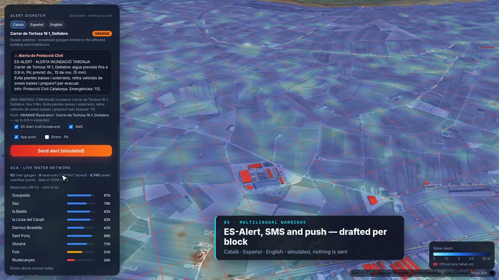

### 6. ACA live water network: dams and river gauges
- **Reservoirs**: fill %, volume, level, release flow and spare capacity (ACA open data).
- **Dam regulation**: the spare capacity of upstream ACA dams absorbs part of the flood volume and lowers the river stage downstream. For example, on the Ter, Susqueda and Sau can still absorb ~81 hm³.
- **River gauges**: flow, its ratio to the 30-day mean, and the last day of 5-minute readings.

| Dam popup | Gauge popup |
|---|---|
| 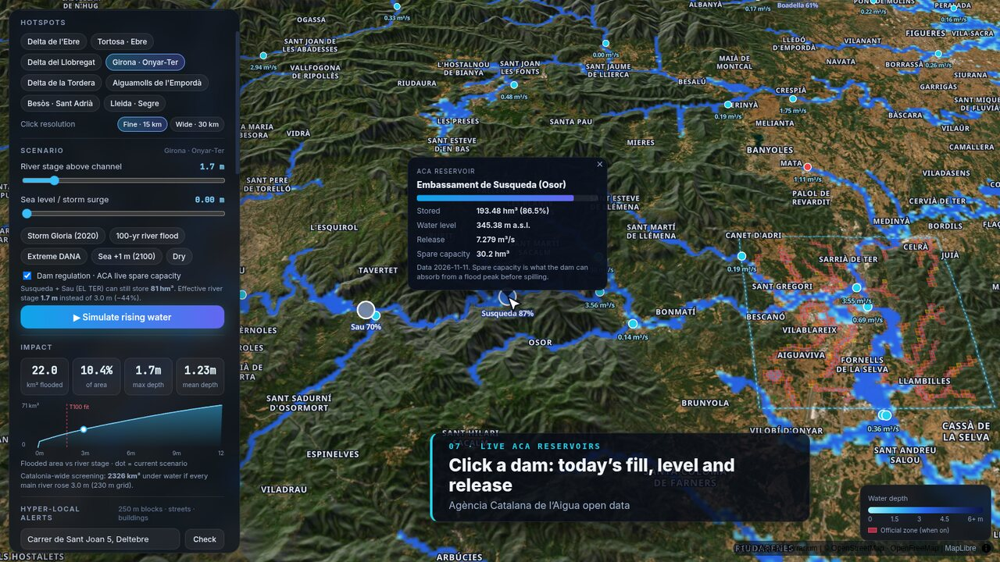 | 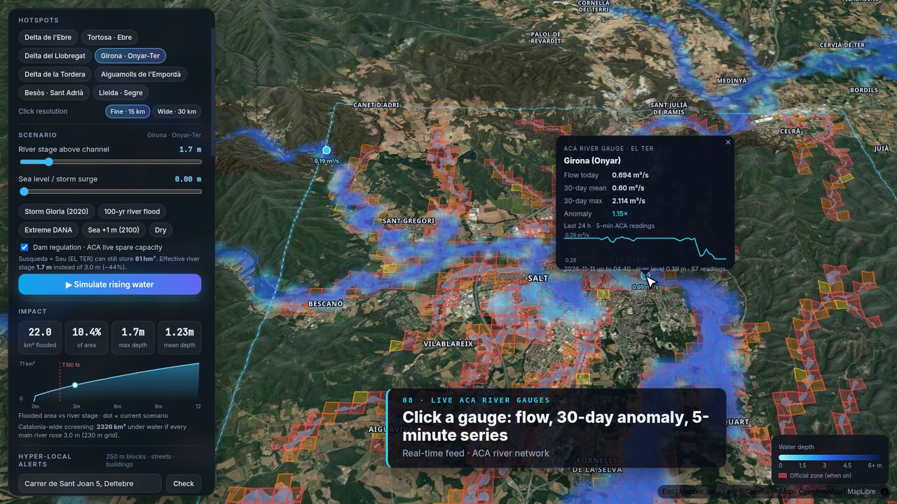 |

### 7. Live readings and forecasts set the scenario
- **📡 Apply today's ACA river readings**: the gauge furthest above its 30-day mean in the basin sets the river stage (`stage = 1.4 · ln(Q / Q̄30)`).
- **☔ Apply forecast scenario**: Open-Meteo 7-day rain plus the GloFAS 30-day river-discharge forecast give an indicative stage.

| Today's ACA readings | Forecast → scenario |
|---|---|
| 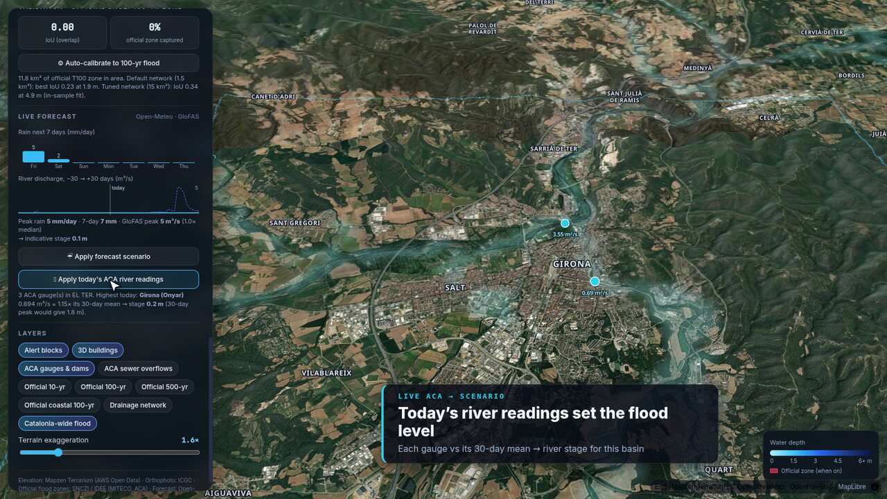 | 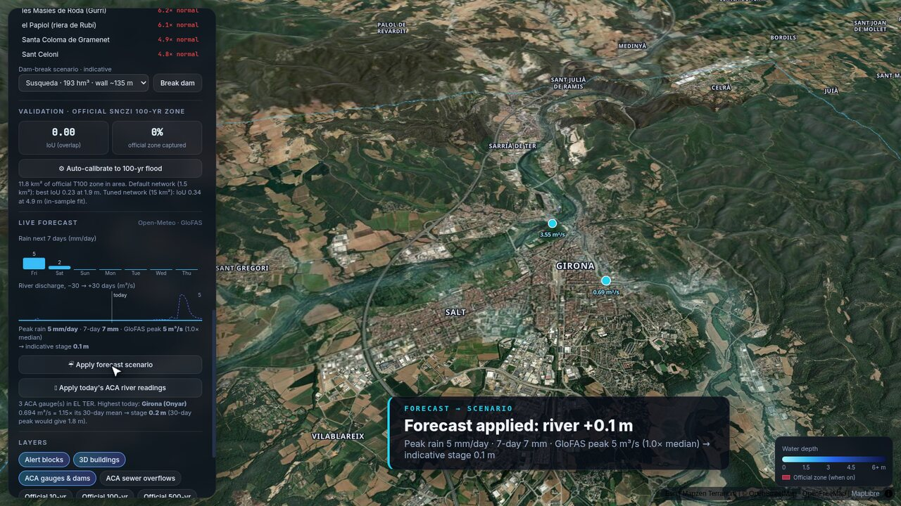 |

### 8. Street level: 25 cm orthophoto and 3D buildings
Zoom anywhere to see ICGC 25 cm aerial imagery, street names and 3D buildings. Buildings hit by the water turn red.

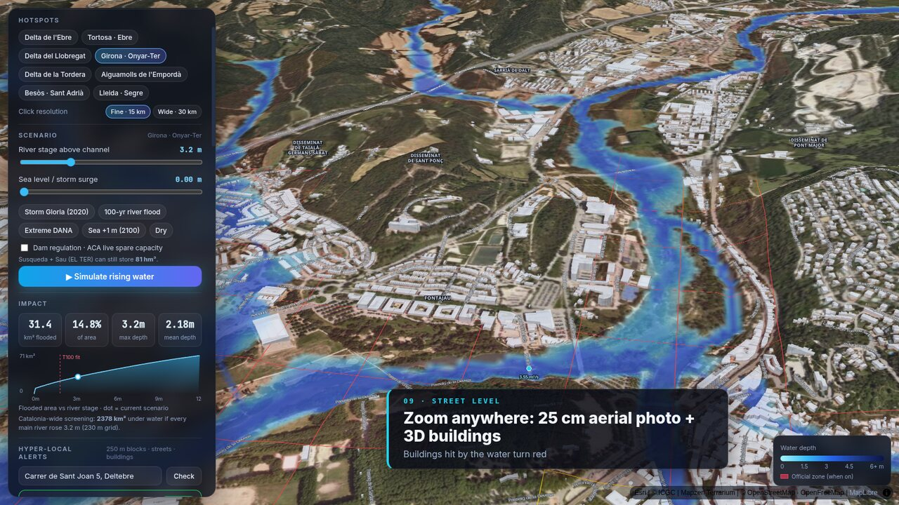

### 9. "What if the dam failed?"
Pick an ACA dam and press *Break dam*. Peak outflow comes from the Froehlich (1995) formula and the wave is attenuated down the valley (Susqueda: 193 hm³, ~74,000 m³/s at the breach). It is a rough, indicative estimate, not an official emergency plan.

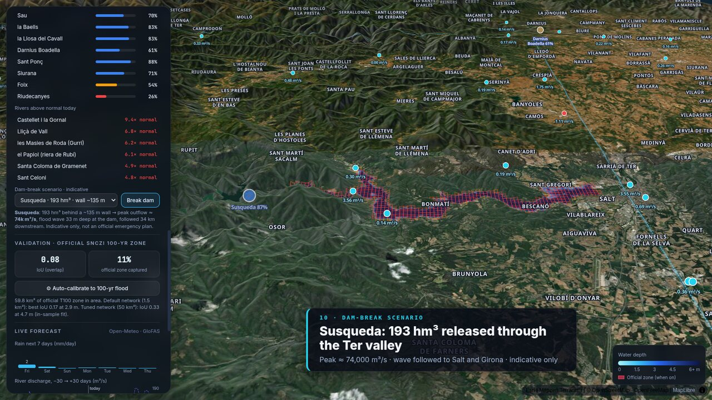

---

## How the model works

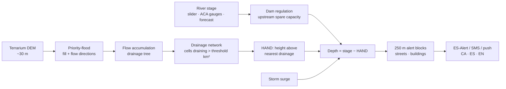

How the drainage behaves when it rains, as shown in the video:

| 1 · Rain runs downhill | 2 · Tributaries gather |
|---|---|
| 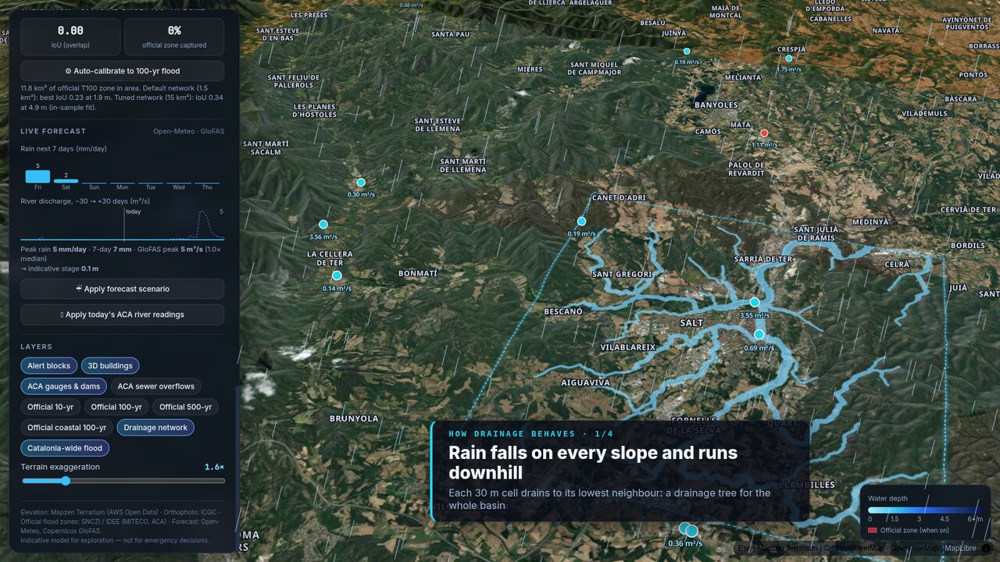 | 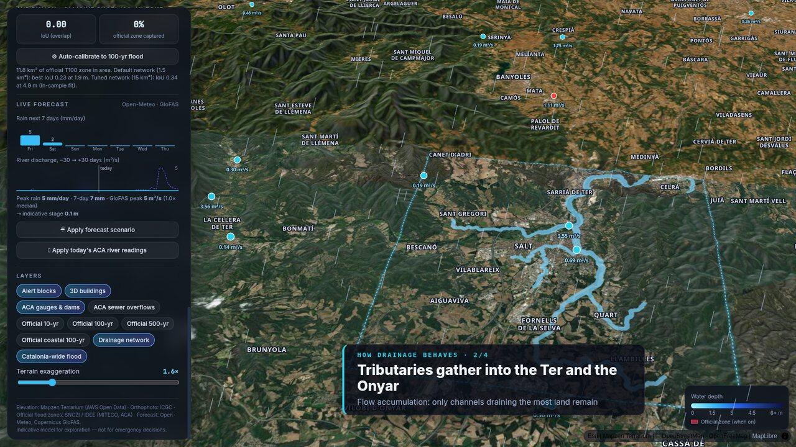 |
| **3 · The channel overflows** | **4 · Low ground floods first** |
| 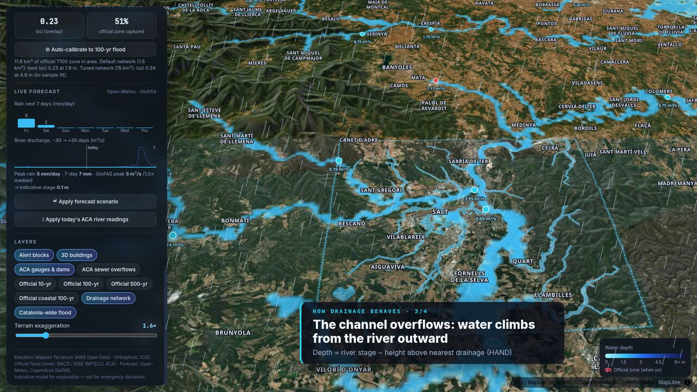 | 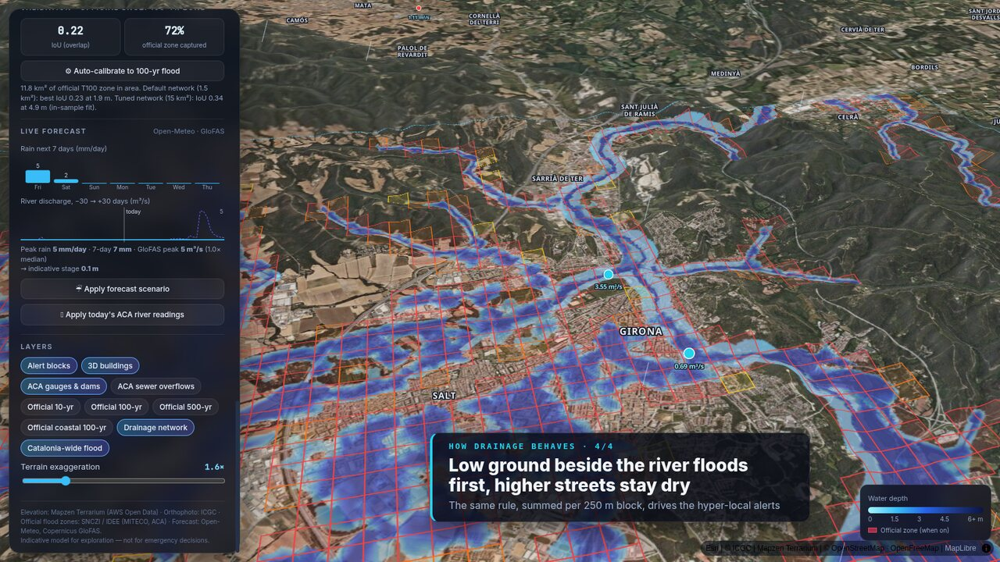 |

1. **Drainage tree.** Each cell drains to its lowest neighbour. A priority-flood pass fills closed depressions, so every cell has a path to the sea or to the edge of the box.
2. **Flow accumulation.** Each cell's contributing area is summed downstream. Cells draining more than a threshold (0.5–150 km², tuned by calibration) form the river network.
3. **HAND.** For every cell, the height above the river cell it drains to.
4. **Depth.** `depth = effective stage − HAND`, plus coastal flooding where the land is below the surge level and connected to the sea.
5. **Alerts.** Depths are summed per 250 m block, then per street and building.

The local water layer is generated as raster tiles on the fly (custom `aiguatwater://` protocol), so it drapes correctly over the 3D terrain at every zoom.

---

## Data sources

| Data | Source |
|---|---|
| Elevation | Mapzen Terrarium tiles (AWS Open Data) |
| Orthophoto 25 cm | ICGC WMTS · Esri World Imagery fallback |
| Streets, labels, 3D buildings | OpenFreeMap (OpenStreetMap) |
| Geocoder | ICGC *geocodificador* |
| Official flood zones T10/T100/T500/coastal | SNCZI · IDEE WMS (MITECO / ACA) |
| Reservoirs | ACA via Transparència Catalunya: `gn9e-3qhr`, real-time `vjx7-6kcp` |
| River gauges | ACA: `2bwe-vgpr`, real-time `3yr3-vq6y`, `hprm-xuw7` |
| Sewer overflows (DSU) | ACA: `qb78-67ft` (4,740 points) |
| Rain forecast | Open-Meteo |
| River discharge forecast | Open-Meteo Flood API (Copernicus GloFAS) |

---

## Validation and limits

Each local run is compared cell by cell with the official SNCZI 100-year zone (IoU). *Auto-calibrate* searches the river stage and the network density that best match it:

| Area | Default IoU | Tuned IoU |
|---|---|---|
| Ebre delta | 0.83 | 0.85 |
| Girona (Onyar–Ter) | 0.23 | 0.34 |

These are **in-sample** scores against the same map the model is tuned on. They show how well the model agrees with that map, not how accurately it predicts floods.

Known limits:
- Terrain only at ~30 m: no hydraulics (no flow velocity or timing), no embankments, river walls, culverts or bridges.
- No urban sewer network: in cities, flooding from rain falling directly on the streets (pluvial flooding) is underestimated.
- Converting forecasts and gauge readings into a river stage uses rules of thumb.
- Dam regulation only covers ACA dams; the Ebre is regulated by CHE reservoirs with no open live feed.
- The ACA real-time feed can lag about a day.
- The dam-break wave stops at the edge of the 60 km box.

---

## Roadmap: how to take the model further

### A. From finding drainage problems to a drainage improvement plan
The model already shows where water collects: which channels carry the most flow, which urban blocks sit only a metre or two above the nearest drainage line, and which blocks go red first as the river rises. Crossed with ACA's 4,740 sewer-overflow points, this is enough to build a **drainage improvement planner**:

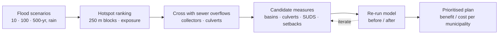

1. **Find the hotspots.** Rank 250 m blocks by how often and how deep they flood across scenarios (10 / 100 / 500-year, rain return periods) and by people and buildings exposed. Mark where the natural drainage network runs into dense urban fabric or crosses roads and railways (likely culvert bottlenecks).
2. **Cross with the sewer network.** Overlay sewer overflow points, collectors and storm tanks (municipal or ACA data) to find blocks where surface water and sewer overflows coincide.
3. **Propose measures.** Generate candidate interventions for each hotspot:
   - retention basins or storm tanks upstream (sized from the contributing area times design rainfall);
   - culvert or collector upgrades where the network crosses infrastructure;
   - green infrastructure (SUDS) such as permeable paving, bioswales and green roofs in the urban part of the basin;
   - floodplain restoration or embankment setbacks along the main channel;
   - early-warning gauges where blocks flood fast and no gauge exists.
4. **Simulate before and after.** Re-run the scenario with each measure, e.g. a retention basin as extra storage (like dam spare capacity) or a culvert upgrade as a lower HAND threshold, and report avoided flooded area, buildings and alert blocks.
5. **Prioritise.** Rank by benefit and cost (avoided damage per euro, people protected) and export a report per municipality, ready for ACA and municipal drainage and flood-risk planning.

### B. Make the physics better
- Higher resolution: the ICGC 2 m / 5 m DEM (LiDAR) instead of 30 m, with buildings and embankments burned in.
- Real hydraulics on the hotspots: a 2D shallow-water solver (e.g. on WebGPU, or offline with HEC-RAS / Iber), using AIGUAT as a fast first screen.
- Rainfall-runoff: SCS-CN or Green-Ampt infiltration with land-cover and soil maps, so rain forecasts drive flows instead of a rule of thumb.
- Pluvial flooding in cities: rain falling directly on the city plus sewer capacity, not only river overflow.
- Out-of-sample validation against observed events (Gloria 2020, DANA 2019/2024, Copernicus EMS flood extents, insurance claims).

### C. Better live data and forecasting
- Meteocat radar and nowcasting, ECMWF / AROME ensembles, and CHE gauges and reservoirs for the Ebre.
- A learned model (e.g. gradient boosting or an LSTM) that maps rain plus upstream gauges to a river stage at each ACA gauge, trained on years of ACA history.
- Probabilistic output: chance of red per block in the next 6 / 24 / 72 h instead of a single scenario.

### D. From demo to an operational service
- Real dispatch through Protecció Civil ES-Alert (cell broadcast), an SMS gateway and web push, with opt-in by address and audit logs.
- Subscriptions for municipalities, insurers and utilities, and an API for block-level risk.
- Precomputed tiles for all of Catalonia at high resolution, served from a CDN.
- Accessibility and more languages (Aranès, Arabic, Romanian…) for the alerts.

---

## Code map

| File | What it does |
|---|---|
| `index.html`, `style.css` | UI layout |
| `app.js` | Map, terrain, scenarios, water rendering, calibration, forecasts, dam regulation and dam-break |
| `model.js` | Priority-flood, flow accumulation, HAND, calibration |
| `local.js` | ACA data, gauges and reservoir popups, 250 m alert blocks, streets and buildings, address lookup, multilingual alert drafts |
| `data/catalonia.png` | Precomputed Catalonia-wide screening layer |
| `tools/build-catalonia.html` | Builds that layer |
